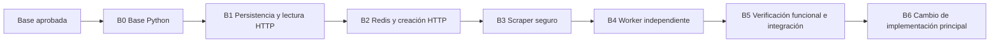

# IntelDigest — Migración del backend a Python / FastAPI

**Estado: M01–M06 implementadas; B1 completa en código y checks disponibles. M04 en `5f069ef` y M05 en `3399287`; M06 añade FastAPI de lectura con lifespan, health y GET por ID, incluida en la unidad de cierre `feat(api): port health and job lookup endpoints`. HTTP verificado en proceso con pool falso; los 12 casos PostgreSQL reales son evidencia del cierre M05, no de HTTP + PostgreSQL en M06. Python todavía no ofrece POST, transporte Redis ni worker ejecutable.** La base Python, tooling y configuración ya existen en `backend/`. Go sigue operativa y sirve como evidencia del comportamiento actual, no como especificación de detalles internos que Python deba reproducir.

**Dirección:** mantener este repositorio y su historial; desarrollar Python idiomático en `backend/`, con FastAPI y las dependencias acordadas. Conservar resultados funcionales, contratos externos y protecciones de producto, no emular mecánicamente Go ni construir capas para imitar sus parsers, tipos, errores o mecanismos.

## 1. Cómo usar este documento

1. Reconciliar Git, ledgers y evidencia antes de cada tarea; no repetir como pendientes M01–M03.
2. Autorizar las unidades restantes según el proceso del proyecto y ejecutarlas con código, tests y documentación juntos.
3. Registrar evidencia real por tarea y cerrar cada rama antes de avanzar.
4. Cambiar el backend principal únicamente después de verificar las garantías funcionales y resolver cualquier brecha real con decisión humana.

Este documento es un procedimiento técnico temporal, no otro roadmap de producto. [PLAN.md](PLAN.md) sigue siendo la fuente de alcance funcional; [README.md](README.md) describe el estado implementado y [AGENTS.md](AGENTS.md) fija las reglas del proyecto. Las referencias a Go de esos documentos siguen describiendo la implementación actual hasta que se actualicen en las unidades correspondientes.

Las tareas futuras y sus comandos/checks propuestos no se consideran ejecutados por figurar aquí. Los resultados de M01–M03 constan en sus ledgers. Este documento no autoriza instalar dependencias adicionales, acceder a secretos, operar servicios, borrar archivos, publicar ramas, abrir PR ni hacer merge.

## 2. Objetivo y alcance de la migración

**Objetivo:** reemplazar Go para las etapas 1–3 por Python idiomático, FastAPI y un worker independiente. Conservar resultados funcionales, contratos externos acordados, protecciones y límites; no conservar por accidente la forma interna Go.

**Compatibilidad funcional** cubre los efectos de producto: interfaz HTTP documentada, persistencia SQL, mensaje Redis v1, persistir antes de publicar y `503` con `job_id`, claim atómico, reglas de ACK, concurrencia y límites acotados, política SSRF/TLS/redirecciones y aislamiento de configuración API/worker. No requiere igualdad byte a byte de errores internos, parser Go, representación/precisión de duraciones, tipos numéricos, logs o APIs de biblioteca.

Usar defaults y adaptadores ordinarios de Python/FastAPI/dependencias cuando sean necesarios para cumplir contratos documentados; no cambiar silenciosamente contratos externos o de datos bajo el argumento de «default nativo». Si una garantía no puede lograrse claramente con el stack acordado, documentar la brecha y pedir decisión humana. No construir emulación Go ni descartar la garantía unilateralmente.

### Incluido

- Configuración por entorno con validación separada para API y worker.
- PostgreSQL, repositorio y transiciones condicionadas por estado.
- API HTTP y publicación de jobs en Redis Streams.
- Consumo Redis, procesamiento, concurrencia acotada y apagado con drenaje.
- Descarga pública segura, extracción Readability y errores clasificados.
- Tests de garantías funcionales, comandos locales y documentación del backend Python; no es necesario trasladar tests de detalles internos sin contrato.

### Excluido

- OpenRouter, contrato del digest y persistencia de estados terminales después del scraping.
- Frontend Next.js, despliegue, DNS y demo pública.
- Reintentos de negocio, recuperación automática de la PEL, DLQ, outbox e idempotencia del POST.
- Cambios del esquema SQL o del formato de mensajes, salvo autorización independiente.
- Añadir cuentas, webhooks, ORM o nuevas plataformas de colas como parte implícita del port.

La migración termina donde termina el código actual: receptor síncrono de metadatos, sin resultado durable. No debe presentarse como un pipeline de digest terminado.

## 3. Ubicación y estrategia de convivencia

| Alternativa | Evaluación |
|---|---|
| Mismo repositorio, Python en `backend/` | Recomendada: historial, contratos y SQL disponibles; comparación local y reversión más simples |
| Otro directorio mediante worktree del mismo repositorio | Útil para aislamiento físico; requiere acordar ruta y registrar el worktree antes de usarlo |
| Directorio nuevo con otro repositorio | No recomendado: fragmenta historia y evidencias; añade coordinación sin resolver el riesgo del port |
| Sustituir Go en el lugar desde el primer día | No recomendado: dificulta comparar y elimina prematuramente la referencia ejecutable |

`backend/` es la ubicación de trabajo estable, no una carpeta descartable. Ya contiene `pyproject.toml`, `uv.lock`, `src/inteldigest/` y `tests/`; las migraciones SQL existentes permanecen en `migrations/`, sin duplicarlas. Las rutas nuevas para futuras tareas se acuerdan dentro de su alcance autorizado.

No ejecutar ambos workers sobre el mismo stream/grupo o base para comparar: competirían por mensajes y modificarían los mismos jobs. Las verificaciones usan estado aislado y servicios expresamente autorizados.

### 3.1. Estructura de paquetes aprobada

Organización objetivo de la migración; no representa archivos ya implementados. Se omiten los `__init__.py` de los paquetes salvo el inicial. Crear cada directorio y módulo solo cuando su tarea lo necesite, nunca como esqueleto vacío anticipado.

```text
backend/
├── pyproject.toml
├── uv.lock
├── README.md
├── src/
│   └── inteldigest/
│       ├── __init__.py
│       ├── config.py
│       ├── jobs/
│       │   ├── models.py
│       │   ├── repository.py
│       │   └── validation.py
│       ├── api/
│       │   ├── app.py
│       │   ├── dependencies.py
│       │   ├── schemas.py
│       │   └── routes/
│       │       ├── health.py
│       │       └── digests.py
│       ├── queue/
│       │   ├── message.py
│       │   ├── publisher.py
│       │   └── consumer.py
│       ├── scraper/
│       │   ├── models.py
│       │   ├── policy.py
│       │   ├── network.py
│       │   ├── fetcher.py
│       │   └── extraction.py
│       └── worker/
│           ├── __main__.py
│           ├── processor.py
│           ├── pool.py
│           └── receiver.py
└── tests/
    ├── conftest.py
    ├── unit/
    │   ├── test_package.py
    │   ├── test_config.py
    │   ├── jobs/
    │   ├── api/
    │   ├── queue/
    │   ├── scraper/
    │   └── worker/
    ├── integration/
    │   ├── conftest.py
    │   └── test_repository.py
    └── fixtures/
        └── scraper/
```

- `config.py` conserva configuración transversal y cargadores API/worker separados; no necesita un paquete artificial de un solo archivo.
- `jobs/` agrupa el modelo compartido, SQL y validación inicial de URL sin DNS. `api/schemas.py` define contratos HTTP deliberados, no la forma de almacenamiento.
- `api/` contiene FastAPI, lifespan, dependencias y rutas; no ejecuta scraping ni consume mensajes. `queue/` contiene el transporte Redis, sin decidir estados de negocio.
- `scraper/` separa política de destinos, conexión validada, descarga y extracción. `worker/` coordina procesamiento, concurrencia, receiver y proceso independiente.
- Tests unitarios sin servicios bajo `tests/unit/`, organizados por paquete; integración real opt-in bajo `tests/integration/`, con sus fixtures allí. `tests/conftest.py` registra la opción de conexión sin abrir servicios. Pytest usa importación `importlib` para permitir módulos homónimos en ambas suites sin alterar `sys.path`.
- SQL sigue en `migrations/` de la raíz, sin duplicarse. No agregar capas genéricas `core/`, `utils/`, `services/` o interfaces sin una necesidad concreta.

**Aplicado para M04:** `jobs/{__init__,models,repository}.py`, `tests/unit/{test_config,test_package}.py`, `tests/unit/jobs/test_repository.py`, `tests/integration/{conftest,test_repository}.py` y el registro de opción en `tests/conftest.py`. M05 amplía el repositorio existente; M06 incorpora `api/{app,dependencies,schemas}.py`, `api/routes/{health,digests}.py` y `tests/unit/api/test_app.py`. No se crean todavía `validation.py`, cola, scraper, worker ni fixtures de artículos.

## 4. Punto de partida y contratos que conservar

La inspección inicial encontró la rama `docs/consolidate-portfolio-plan` limpia, aproximadamente 2.712 líneas en 15 archivos Go productivos y 5.546 líneas en 16 archivos Go de tests. Estos datos son históricos: revalidarlos antes de implementar.

| ID | Garantía funcional / contrato externo | Referencia actual |
|---|---|---|
| C1 | Conservar rutas, métodos, status HTTP, JSON y errores que forman parte de la interfaz pública; definir deliberadamente validación de URL, UUID, campos ausentes y serialización. No reproducir mensajes internos no contractuales byte por byte | `internal/api/handler.go`, `internal/models/` y sus tests |
| C2 | Crear el job antes de publicar; fallo de publicación devuelve `503` con `job_id` y conserva el registro; no prometer atomicidad ni idempotencia | `internal/api/handler.go`, `README.md` |
| C3 | Mantener tabla, UUID, timestamps, nulos y JSONB; claim mediante `UPDATE ... WHERE status = 'pending'`, con un solo ganador | `migrations/`, `internal/db/` |
| C4 | Campo Redis `data` con JSON `schema_version=1`, `job_id`, `url`; conservar validación y semántica de grupos/lectura | `internal/queue/` |
| C5 | Leer entradas nuevas; ACK solo para duplicados terminales; scraping normal y errores siguen sin ACK y con job `processing` | `internal/worker/`, `internal/queue/consumer.go` |
| C6 | Pool fijo sin cola acumulativa; detener admisión, drenar, cancelar y esperar tareas antes de cerrar clientes; drenaje no equivale a plazo rígido de salida | `internal/worker/pool.go`, `cmd/worker/` |
| C7 | Política explícita de URL/IP/DNS, conexión a IP validada, TLS y hostname normales, redirecciones revalidadas, sin proxies implícitos ni downgrade HTTPS | `internal/scraper/network.go`, `internal/scraper/scraper.go` |
| C8 | Límites de conexión, TLS, headers, lectura, solicitud total, cuerpo descomprimido y redirecciones; errores seguros sin artículo ni secretos en logs | `internal/scraper/`, `internal/config/` |
| C9 | Mantener extracción de texto útil, título e idioma cuando corresponda; clasificar ausencia de artículo y registrar diferencias del extractor | `internal/scraper/types.go`, fixtures y tests |
| C10 | API y worker separados; opciones exclusivas del worker no invalidan el arranque de la API; conservar variables, defaults y límites de producto acordados. La sintaxis Python de duración es segundos numéricos, no sintaxis Go | `internal/config/`, `cmd/api/`, `cmd/worker/`, loaders Python M03 |

Los tests y el código Go son evidencia de escenarios y resultados, no una orden de copiar mecanismos internos. Inventariar casos externos y resultados esperados. FastAPI/Pydantic pueden requerir adaptadores ordinarios para conservar status, JSON y validación contractual; no introducir silenciosamente `422`, JSON `detail` o normalizaciones públicas distintas. Tampoco reproducir excepciones léxicas, errores internos o coerciones Go sin razón funcional. La configuración Python ya usa segundos numéricos (`5`, `0.5`) y campos `_seconds`; no volver a exigir sintaxis Go, nanosegundos ni límites `int64` como paridad.

## 5. Stack propuesto y decisiones técnicas previas

| Necesidad | Propuesta | Condición |
|---|---|---|
| HTTP / ASGI | FastAPI y Uvicorn | API sin scraping ni consumo Redis dentro del handler |
| Validación | Pydantic | Validadores y respuestas adaptados al contrato existente |
| PostgreSQL | asyncpg con SQL parametrizado | Sin ORM obligatorio; codecs y serialización JSONB explícitos |
| Redis | redis-py mediante `redis.asyncio` | Streams existentes, sin Celery ni cambio de broker |
| Descarga | aiohttp con resolver/conector sujeto a la política de seguridad | No aceptar un simple chequeo previo seguido de una resolución independiente |
| Extracción | readability-lxml y lxml | Mantener la familia Readability; comprobar texto, charset, título e idioma |
| Pruebas | pytest, pytest-asyncio y HTTPX para la API | Dobles deterministas; sin consumo de crédito |
| Utilidades | Biblioteca estándar | `asyncio`, UUID, logging, señales, IPs y configuración simple |

B0 ya está completada: Python 3.14.8, uv 0.13.1, Pydantic 2 y dependencias acordadas están instalados/bloqueados según `backend/`; Ruff 0.17.3 es lint de desarrollo, no formatter ni type checker. Los ledgers [M01–M03](odd/tasks/python-migration-m01.md) y [corrección M03](odd/tasks/python-config-simplification.md), junto con [backend/README.md](backend/README.md), registran entregas y límites. No describir M01–M06 como pendientes de implementación. B1 tiene código y tests de repositorio/lectura HTTP; M04/M05 cuentan con 12 casos PostgreSQL reales y M06 con tests HTTP deterministas sin servicios. M07+ no comenzó.

Las bibliotecas no resuelven automáticamente la seguridad. El resolver/conector de aiohttp no es por sí solo defensa SSRF: verificar IPs literales, DNS mixto, caché/reutilización, redirecciones y TLS con una política segura equivalente en resultado. No sustituir la validación explícita por una propiedad simplista como `ipaddress.is_private`; mantener TLS normal, revalidar redirecciones y excluir proxies implícitos.

La extracción Readability síncrona necesita una estrategia acotada que no bloquee el loop. No asumir que cancelar un await detiene una función ya ejecutada en thread, ni que FastAPI/asyncio/dependencias garantizan por sí solos cancelación y apagado requeridos. Verificar drenaje, recursos y límites.

## 6. Reglas de ramas y commits

- Registrar la base aprobada con su SHA completo. La rama inspeccionada contiene documentación que no debe perderse; no asumir que `main` ya la incluye.
- Cada rama Bn parte de la punta verificada de Bn−1. La cadena siguiente expresa dependencias locales, no autorización para merge ni PR.
- No desarrollar producto nuevo en paralelo sobre esta cadena durante la migración.
- Cada tarea entrega un comportamiento verificable con sus tests y documentación; no separar commits por tipo de archivo.
- Objetivo: unas 400 líneas modificadas por unidad revisable. Si una tarea lo supera, dividirla por subcomportamientos antes de escribir; registrar IDs derivados y mensajes. No quitar tests para alcanzar el presupuesto.
- Las unidades de seguridad, concurrencia, configuración pública y dependencias llevan riesgo explícito y verificación independiente según las reglas del harness. No agruparlas con cambios ajenos.
- Los mensajes de la sección 7 son propuestas. Registrar el SHA real después del commit; nunca marcar una tarea completa por haber creado el commit solamente.
- Commits locales de implementación se ejecutan cuando se autorice esa implementación y conforme a ODD. Este documento no autoriza un commit ahora. Push, PR, merge, rebase destructivo y borrado tienen su autorización correspondiente.



## 7. Ramas, tareas y commits propuestos

M01–M06 están implementadas; M04 está entregada en `5f069ef` y M05 en `3399287`. M05 cuenta con verificación independiente e integración PostgreSQL real (12/12). M06 tiene lectura HTTP y lifespan verificados con dobles en proceso, incluidos en su unidad de cierre. M07–M20 siguen propuestas y pendientes, sin implicar autorización para ejecutarlas. Cada fila es una unidad propuesta, sujeta a subdivisión por presupuesto. Los cierres de rama exigen checks observados, no solo código escrito. La evidencia B0 está en los ledgers enlazados arriba.

### B0 — `migration/python-foundation`

| Tarea | Entrega | Commit propuesto |
|---|---|---|
| M01 | Inventario de contratos C1–C10 y escenarios Go; base fijada | `docs(migration): capture backend compatibility baseline` — completada |
| M02 | Paquete Python instalable, dependencias justificadas/bloqueadas, runner de tests y guía sin dotenv | `build(python): establish reproducible backend tooling` — completada |
| M03 | Cargadores separados API/worker, defaults y límites útiles con segundos numéricos Python; tests sin conexiones externas | `feat(config): preserve backend environment contracts` y corrección `refactor(config): use idiomatic Python settings` — completada; ledgers B0 y corrección M03 |

**Cierre (completado):** tooling reproducible, smoke test de paquete y validación pasiva de configuración; Go intacta. Véanse los ledgers M01–M03. No queda trabajo B0 pendiente.

### B1 — `migration/python-storage-api`

| Tarea | Entrega | Commit propuesto |
|---|---|---|
| M04 | Crear/consultar jobs con SQL existente y serialización conforme a los datos y efectos documentados; pruebas unitarias y casos de integración — implementada y organizada en `5f069ef`; integración PostgreSQL verificada en el cierre M05 | `feat(db): port job creation and lookup to Python` |
| M05 | Claim atómico y diagnóstico intermedio condicionado y acotado; pruebas del único ganador y estado conservado — implementada en `3399287`, verificada independientemente; integración PostgreSQL real 12/12 | `feat(db): preserve atomic claims and scrape diagnostics` |
| M06 | FastAPI con lifespan, health y GET por ID; preservar contratos HTTP públicos, campos nulos y significado/formato documentado de UUID y timestamps, usando validación/serialización idiomáticas y adaptadores ordinarios; implementada y verificada con tests HTTP en proceso y docs de arranque | `feat(api): port health and job lookup endpoints` |

**Cierre B1 (implementado):** 38 tests M06 de lectura HTTP/lifespan pasan con pool falso; suite Python 137 passed / 12 skipped y Ruff limpio. Los 12 skips son integración PostgreSQL opt-in, ya ejecutada en M05 y no repetida en M06. No se ejecutó HTTP + PostgreSQL real ni se operaron servicios. GET conserva 400/404/500, UUID canónico, timestamps con zona y omisión de campos nulos; HEAD disponible. POST aún no está disponible en Python. Detalles y arranque: [backend/README.md](backend/README.md#read-only-http-api-m06).

### B2 — `migration/python-redis-api`

| Tarea | Entrega | Commit propuesto |
|---|---|---|
| M07 | Mensaje v1 y publicación `XADD`, configuración y timeout; tests del JSON dentro de `data` | `feat(queue): preserve Redis job publication protocol` |
| M08 | POST completo: validación, persistencia y publicación; `202`, errores y `503` con registro conservado | `feat(api): preserve digest submission semantics` |
| M09 | Grupo idempotente, lectura nueva acotada, `NOGROUP` y ACK sin borrar entradas; tests y docs | `feat(queue): port bounded stream consumption` |

**Cierre:** API Python y transporte completos frente a los escenarios aplicables; no se activa un worker real. Mantener validación inicial sin resolver DNS. Riesgo: contratos y comportamiento ante fallos.

### B3 — `migration/python-safe-scraper`

| Tarea | Entrega | Commit propuesto |
|---|---|---|
| M10 | Política de sintaxis, hosts, puertos, rangos IP y formatos ambiguos; casos permitidos y rechazados | `feat(scraper): preserve public destination validation` |
| M11 | Resolver/conector con resolución y conexión acopladas, DNS mixto rechazado, TLS/hostname normales y proxies deshabilitados | `feat(scraper): pin connections to validated public addresses` |
| M12 | Descarga con redirecciones revalidadas, downgrade rechazado y presupuestos de tiempo/cuerpo descomprimido | `feat(scraper): preserve bounded fetch and redirect safety` |
| M13 | Extracción Readability, charset, metadatos y errores tipados; fixtures comparadas y ejecución acotada | `feat(scraper): port article extraction and safe diagnostics` |

**Cierre:** suite de seguridad con dobles locales, DNS rebinding, IPs literales, certificados inválidos, compresión y límites. Registrar diferencias de extracción; no prometer igualdad textual entre implementaciones. Diferencias relevantes requieren decisión, no aprobación automática. Riesgos: seguridad y recursos; verificación independiente requerida.

### B4 — `migration/python-worker`

| Tarea | Entrega | Commit propuesto |
|---|---|---|
| M14 | Procesador: claim, duplicados, errores y receiver síncrono de metadatos; ningún ACK normal ni estado terminal nuevo | `feat(worker): preserve job processing and acknowledgement rules` |
| M15 | Concurrencia acotada sin cola acumulativa, presupuestos de operación y comportamiento requerido de admisión, drenaje/cancelación y cierre; seleccionar primitives Python idiomáticas, sin obligación de simular goroutines/channels | `feat(worker): port bounded concurrency and graceful drain` |
| M16 | Entrada de proceso independiente, señales antes de iniciar dependencias, grupo antes de leer y cierre después del join | `feat(worker): wire standalone Python worker lifecycle` |

**Cierre:** arranque probado con fakes, apagado durante lecturas y trabajo activo, cancelaciones y errores de dependencia; sin tareas huérfanas ni clientes cerrados prematuramente. Riesgo: concurrencia; verificación independiente requerida.

### B5 — `migration/python-parity`

| Tarea | Entrega | Commit propuesto |
|---|---|---|
| M17 | Harnesses aislados y serializados PostgreSQL/Redis; cubrir publicación, claims, duplicados, ACK y reinicio sin recuperación | `test(integration): verify Python backend service boundaries` |
| M18 | Verificación reproducible de contratos y garantías funcionales C1–C10 con evidencia y límites; comparación Go/Python sirve para detectar diferencias, no exige imitar comportamientos internos no contractuales | `test(migration): establish backend compatibility evidence` |

**Cierre:** checks completos con evidencia actual y garantías funcionales cubiertas; ninguna brecha contractual no resuelta. Si falta autorización o infraestructura para probar integración, queda pendiente: no afirmar cobertura no observada. El scraper real se verifica por separado; integración con scraper falso no prueba todo el circuito HTTP. Una diferencia interna de parser, error o representación no es por sí sola una brecha de producto.

### B6 — `migration/python-cutover`

| Tarea | Entrega | Commit propuesto |
|---|---|---|
| M19 | Python como backend documentado principal; adaptar Makefile, README, PLAN y AGENTS, diagramas y comandos conservando alcance pendiente | `docs(migration): promote Python backend workflows` |
| M20 | Retirar Go y dependencias/runners obsoletos únicamente con autorización explícita y garantías funcionales verificadas; comprobar paquete final | `refactor(migration): retire superseded Go backend` |

**Cierre:** un solo backend mantenido, comandos coherentes y limitaciones explícitas. No borrar SQL ni datos. Si se decide conservar Go temporalmente, M20 queda diferida con motivo y la retirada no se declara terminada. Riesgos: entorno, contratos de comandos y retirada de implementación.

## 8. Verificación y evidencia por tarea

### Desarrollo y compatibilidad

- Para comportamiento determinista: escribir el caso solicitado, observar RED, implementar lo mínimo y observar GREEN. Cubrir también comportamiento previo compartido que se toque.
- Ejecutar tests focalizados y suite aplicable. Documentación pasiva se verifica estructuralmente; no inventar RED de runtime para documentos.
- Verificar por interfaces públicas: status HTTP, JSON, mensajes Redis y efectos persistidos; ante rechazo, ausencia de mutaciones no permitidas.
- Comparar Go/Python con casos representativos en estado aislado para detectar diferencias en resultados externos. Comparar UUID/timestamps por formato y semántica contractual cuando sean generados, no por precisión interna incidental.
- Para CLI: comprobar exit code, stdout y stderr solo cuando sean contratos operativos acordados; para señales, límites y cierre de recursos verificar los resultados requeridos, no clonar mecanismos internos. No exigir igualdad literal de logs internos.
- Portar tests por reglas funcionales observables; no exigir el mismo número de líneas ni trasladar goroutines, channels, `net/url`, `time.Duration`, nanosegundos o representación `int64` a Python. Elegir idiomáticamente entre async/await, APIs de bibliotecas y tipos nativos.
- Mantener checks Go mientras siga siendo referencia. Tooling Python ya está fijado en `backend/README.md`; pytest y Ruff son parte del setup existente. No añadir formatter ni type checker/dependencia por inercia.
- Seguridad y concurrencia requieren verificación independiente; native review solo conforme al switch RDD y su autoridad, sin sustituir pruebas funcionales.

### Operaciones y restricciones

- No leer, buscar, editar, cargar ni acceder indirectamente a `.env` o `.env.*`, incluido `.env.example`. Usar configuración de pruebas explícita y entorno proporcionado por la persona.
- No instalar paquetes, iniciar/parar servicios, ejecutar Compose ni aplicar migraciones como paso implícito del plan.
- Integración PostgreSQL requiere permiso explícito para eliminar/recrear `inteldigest_test`, instancia local no compartida y ejecución serializada; no tocar `inteldigest` ni su volumen.
- Redis usa claves propias y únicas con cleanup limitado; nunca `FLUSHDB`/`FLUSHALL`.
- Tests de HTTP, DNS, TLS, extracción e IA futura usan dobles deterministas; no llamar a servicios pagos ni recorrer URLs arbitrarias para probar.
- No atribuir al estado actual una prueba histórica: registrar comando, resultado, fecha/contexto y limitaciones de cada ejecución real.

## 9. Cambio operativo y reversión

Antes de sustituir procesos existentes, preguntar si hay servicios activos, datos o jobs que deban preservarse. No inferir que el entorno está vacío ni inspeccionar secretos para averiguarlo.

1. Registrar el SHA Go conocido y la configuración no secreta necesaria para volver a arrancarlo.
2. Confirmar compatibilidad de SQL y mensajes y resultados de B5.
3. Acordar ventana y destino del cambio; detener/admitir trabajo solo con autorización operativa.
4. Cambiar API y worker de manera controlada, sin dos consumidores de comparación compitiendo sobre el mismo estado.
5. Comprobar salud, creación, consulta y procesamiento hasta el límite actual, sin anunciar digest final.
6. Si falla, detener Python y restaurar procesos de la referencia Go según el procedimiento autorizado. Volver al código anterior no revierte claims ni limpia la PEL.

No hacer reset destructivo, vaciar Redis ni reiniciar estados de jobs para simular una reversión. Los jobs `processing`/PEL requieren una decisión manual explícita; no añadir recuperación automática como parche de migración.

## 10. Seguimiento para sesiones futuras

Este archivo conserva la estrategia. Los ledgers ODD de M01–M03 ya existen bajo `odd/tasks/`; para la siguiente tarea autorizada, continuar el ledger requerido y su espejo de memoria con referencia a las tareas pertinentes, sin duplicar el roadmap funcional de PLAN.md.

Por cada tarea registrar en ese ledger: rama, contratos C1–C10 cubiertos, rutas permitidas, riesgo, subunidades, tests RED/GREEN cuando apliquen, checks con salida/exit code, SHA del commit y bloqueo concreto si lo hay. Proyectar las tareas activas en la lista visible. No crear ahora esos artefactos de implementación.

Al retomar: leer los ledgers existentes, este documento, PLAN.md y Git; reconciliar evidencia antes de la siguiente tarea. M01–M03 están cerradas según sus registros. Una tarea posterior sin evidencia queda pendiente aunque exista código.

### Criterios de aceptación globales

- [x] Ubicación y comienzo registrados; base y evidencia inicial en ledger M01.
- [x] Dependencias justificadas y entorno reproducible (M02).
- [ ] Garantías funcionales C1–C10 cubiertas en la implementación, con brechas resueltas explícitamente.
- [ ] API y worker Python independientes, con límites y configuración que cumplen las garantías funcionales acordadas.
- [ ] SSRF/TLS/redirecciones y apagado concurrente verificados de forma independiente.
- [ ] Tests unitarios e integración autorizada ejecutados; fallos, omisiones y pendientes visibles.
- [ ] Documentación y comandos reflejan Python sin marcar IA/frontend/despliegue como terminados.
- [ ] Cambio operativo y reversión acordados; retirada de Go autorizada por separado.
- [ ] No se añadieron funciones fuera de alcance ni se modificaron datos incidentalmente.

## 11. Próxima decisión

**M06 completada; cierre B1.** La unidad `feat(api): port health and job lookup endpoints` parte de M05 `339928734944a80a89b4ca1c1d268aa1a1075ccd` en `migration/python-storage-api`; no incluye el diff acumulado M04/M05. El SHA de entrega se consulta en Git para no introducir una referencia al propio commit. Se verificó RED por módulo ausente y GREEN de los 38 casos HTTP/lifespan, suite 137 passed / 12 skipped y Ruff limpio. Starlette emite una advertencia de deprecación HTTPX; no se cambian dependencias para ocultarla. Durante la implementación no se ejecutó integración real ni se operaron servicios o leyeron dotenv. Posteriormente, por autorización humana, se inició solo PostgreSQL sin dotenv y se comprobó en lectura la tabla `jobs` y un job existente; eso no prueba HTTP + PostgreSQL. La persona autorizó el commit M06 y el push de B1; no autorizó PR, merge ni comenzar B2. El próximo paso de desarrollo, tras autorización, es B2 (M07–M09: Redis y POST).
