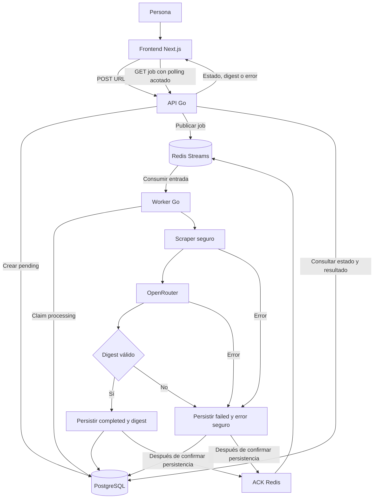

# IntelDigest — Plan único del proyecto

## Objetivo y alcance

Proyecto personal de portfolio que demuestra una API asíncrona en Go, Redis Streams como broker y procesamiento con IA mediante una API key de OpenRouter, con un frontend Next.js y una demo desplegada en un subdominio propio. El resultado final será una aplicación pequeña, comprensible y verificable, no una plataforma SaaS ni un servicio con garantías de producción.

Una persona envía la URL pública de un artículo técnico, recibe un `job_id` y consulta luego un digest estructurado o un error seguro. La API responde sin hacer scraping ni llamadas a IA dentro de la petición.

Este archivo es la única fuente del objetivo, las etapas y el trabajo pendiente. [README.md](README.md) explica cómo usar la implementación actual; [AGENTS.md](AGENTS.md) contiene convenciones, comandos y reglas internas. Los planes y registros anteriores se conservan en el historial de Git, no como documentos paralelos.

## Resultado final esperado

Diagrama objetivo: incluye etapas todavía pendientes, no el estado implementado.

- Dos procesos independientes: `cmd/api` y `cmd/worker`.
- PostgreSQL como fuente de verdad del job y del digest final en `result JSONB`.
- Redis Streams con grupos de consumidores para desacoplar recepción y procesamiento.
- Un único cliente HTTP OpenRouter, una API key y un modelo configurable compatible con salida estructurada.
- Pool acotado, protección SSRF y límites explícitos de red, tamaño y tiempo.
- Frontend Next.js + TypeScript: enviar URL, mostrar progreso y presentar digest o error; `curl` seguirá disponible para verificar la API.
- Frontend desplegado en Vercel como opción recomendada, con un subdominio del dominio de la persona. Backend en un proveedor con procesos persistentes, por decidir antes del despliegue.

## Etapas terminadas

| Etapa | Entrega implementada |
|---|---|
| 1. Base de datos y API | Migración SQL versionada, creación y consulta de jobs, validación de URL, `POST /api/v1/digests`, `GET /api/v1/digests/{id}` y `/healthz` |
| 2. Publicación y consumo Redis | Mensaje `schema_version=1`, `job_id`, `url`; publicación después de persistir; consumer group y lectura de entradas nuevas |
| 3. Worker y scraper | Claim atómico `pending -> processing`, pool fijo, apagado con drenaje, descarga segura y extracción de texto con Readability |

Estas etapas tienen tests unitarios y harnesses de integración. El historial conserva la verificación de PostgreSQL/Redis reales con scraper falso; eso no equivale a una demo HTTP/IA completa ni prueba que los servicios estén disponibles hoy.

### Límite exacto de la implementación actual

El pipeline termina en un receptor síncrono en memoria que registra metadatos y descarta el texto. Todavía no llama a OpenRouter, no guarda un digest y no marca `completed` ni `failed` después del scraping. Un error de scraping puede registrar un diagnóstico intermedio, pero el job sigue `processing`.

Las entradas procesadas normalmente permanecen pendientes de ACK en Redis. Solo los duplicados cuyo job ya está en estado terminal se ACKean. No hay reintentos ni recuperación automática de trabajos después de una caída.

Ya están decididos Redis Streams, Readability y las migraciones SQL versionadas; no volver a tratarlos como elecciones abiertas.

## Etapas pendientes, en orden

### 4. Contrato del digest y cliente OpenRouter

**Entrega:** cliente aislado, testeable y con resultado tipado. Todavía no confundirlo con un job terminado.

- Acordar el JSON del digest y su idioma antes de implementar. Base recomendada: título, resumen, puntos clave, categorías, tecnologías mencionadas y dificultad. Definir campos obligatorios y límites; no agregar análisis ajenos al objetivo.
- Crear tipos de dominio y validar el contenido recibido, no solo que sea JSON sintácticamente válido.
- Implementar un cliente HTTP propio en `internal/ai`, con Bearer auth, modelo configurable y salida con esquema estricto cuando el modelo/proveedor lo soporte.
- Usar `OPENROUTER_API_KEY` y proponer `OPENROUTER_MODEL`; el cliente y la configuración de modelo todavía no existen. La configuración de IA será exclusiva del worker.
- Verificar documentación vigente y compatibilidad antes de fijar el modelo y los parámetros. No elegir un modelo por un ejemplo histórico.
- Limitar entrada, respuesta y duración. Ante un artículo que exceda el presupuesto acordado, devolver un error explícito en lugar de truncarlo silenciosamente.
- Tratar el artículo como datos no confiables, no como instrucciones para el modelo.
- Probar éxito, respuestas malformadas, rechazo del esquema, errores HTTP y timeout mediante un servidor HTTP de pruebas. No consumir crédito para tests automatizados.

**Cierre:** se obtiene un digest válido o un error clasificado y seguro; no se filtran claves ni contenido completo en logs.

### 5. Conectar IA y consolidar el job

**Entrega:** circuito de procesamiento completo, con resultado durable antes del ACK.

- Revisar el contrato de `internal/worker/receiver.go` y conectar el cliente de IA al procesamiento existente sin aumentar la concurrencia fuera del pool.
- En éxito, validar el digest y guardar `completed`, `result` y limpieza del error previo.
- En fallo de scraping, IA o validación, guardar `failed` con un mensaje seguro. Clasificar la causa no implica activar reintentos automáticos.
- ACKear la entrada Redis solo después de confirmar la persistencia del estado terminal. Si falla esa escritura, no simular éxito ni ACKear.
- Mantener transiciones condicionadas por estado y el tratamiento idempotente de duplicados terminales.
- Confirmar que GET expone una respuesta estable: estado intermedio, digest final o error según corresponda.
- Probar el circuito con PostgreSQL/Redis reales y dobles deterministas para servicios externos; ejecutar la integración de forma aislada y serializada.

**Cierre:** una URL válida termina en `completed` con digest consultable; un fallo de procesamiento termina en `failed` con diagnóstico seguro. Las entradas alcanzan ACK únicamente después del estado terminal persistido.

### 6. Frontend Next.js

**Entrega:** interfaz pequeña que consume la API existente, sin replicar el procesamiento en Next.js.

- Usar Next.js + TypeScript; elegir versión estable y organización del frontend cuando se autorice implementarlo, sin crear otro plan paralelo.
- Formulario de URL, estado de envío y seguimiento del `job_id` con polling acotado que termina en estado terminal, error de consulta o límite de espera.
- Mostrar resumen, puntos clave y demás campos del digest acordado; presentar errores legibles y estados vacíos/carga.
- Mantener la API key de OpenRouter exclusivamente en el worker. Nunca exponerla en el navegador, variables `NEXT_PUBLIC_*` ni respuestas HTTP.
- Definir integración entre frontend y API: si el navegador llama a otro origen, configurar CORS con orígenes explícitos. Un proxy Next.js es una alternativa por evaluar, no una segunda implementación del backend.
- Verificar formulario, polling y estados mediante tests, compilación y prueba de navegador.

**Cierre:** el recorrido URL -> espera -> digest/error funciona desde la interfaz con backend local terminado.

### 7. Despliegue de la demo

**Entrega:** frontend accesible por HTTPS en un subdominio propio y backend disponible para la demo.

- Recomendar Vercel para Next.js. Registrar el subdominio y usar el CNAME que indique el proyecto, sin mover innecesariamente el DNS de todo el dominio.
- Elegir hosting del backend según presupuesto mensual y nivel de mantenimiento aceptable; revisar la propuesta de hosting de abajo antes de contratar.
- Ejecutar API y worker como servicios separados y persistentes. No intentar mantener el consumidor Redis permanente dentro de una Vercel Function.
- Mantener PostgreSQL y Redis en red privada del backend, con almacenamiento persistente y configuración apropiada para Streams; no exponerlos al navegador.
- Preparar build/start de ambos binarios, puerto esperado por el proveedor frente a `API_PORT`, variables y secretos, migración inicial controlada, HTTPS y comprobaciones de disponibilidad. Estas adaptaciones aún no están implementadas.
- Antes de abrir acceso público, acordar controles mínimos contra abuso: límites de creación y concurrencia, presupuesto/cuota de IA y mecanismo de acceso restringido o protección de la demo. CORS no reemplaza estos controles.
- Definir cómo detectar y tratar manualmente jobs atascados durante reinicios/despliegues, sin prometer recuperación automática.
- Autorizar por separado contratación, publicación, DNS, migraciones y consumo de crédito. No suponer que frontend gratuito implica backend o IA gratuitos.

**Cierre:** frontend y backend verificados juntos en el entorno elegido, secretos protegidos y costos/acceso acotados.

### 8. Cerrar y presentar el portfolio

**Entrega:** una persona puede probar la demo y explicar el proyecto siguiendo el README.

- Actualizar README, flowcharts Mermaid y ejemplos de configuración con el estado real, URLs públicas y pasos locales. Los archivos dotenv continúan bajo manejo humano.
- Documentar compilación del frontend y backend, arranque y consulta por `curl` hasta estado terminal.
- Realizar una demo real de scraping + OpenRouter con autorización para usar la API key y consumir crédito; no es un test rutinario.
- Mostrar un caso exitoso y un fallo controlado desde el frontend, y conservar evidencia sin secretos.
- Explicar el papel de Redis, la separación API/worker, el pool, SSRF y la validación del resultado de IA.
- Documentar limitaciones operativas, controles de acceso/costos y cómo detener la demo; comprobar que el repositorio no contiene credenciales.

**Cierre del proyecto:** demo desplegada en un subdominio propio, reproducible localmente, con frontend Next.js, digest persistido y consultable, errores observables, checks aplicables y documentación coherente.

## Propuesta de hosting, pendiente de elección final

| Componente | Opción recomendada | Motivo |
|---|---|---|
| Frontend Next.js | Vercel | Integración con Next.js y subdominio propio con HTTPS |
| API Go y worker Go | Railway, dos servicios persistentes | Mantener el modelo actual de procesos separados sin administrar un servidor |
| PostgreSQL y Redis | Servicios del mismo proyecto/región del backend | Reducir conexiones externas y usar red privada y almacenamiento persistente |

Render es una alternativa: servicio web para la API, background worker continuo, PostgreSQL y almacenamiento Redis-compatible. Un VPS permite reunir los servicios, pero requiere mantener sistema, TLS, backups y seguridad; no es la primera recomendación para minimizar operación.

La recomendación inicial es **Vercel + Railway**, no una contratación decidida. Antes de elegir, confirmar costo del conjunto API + worker + PostgreSQL + Redis, persistencia, compatibilidad de comandos Redis Streams y condiciones de disponibilidad. No asumir que todos estos servicios entran en un plan gratuito ni elegir una instancia que suspenda el worker mientras esperamos consumo continuo.

Un único subdominio propio para el frontend es suficiente; la API puede usar inicialmente la URL HTTPS del proveedor. Un segundo subdominio para la API es opcional. El dominio real y los registros DNS se acuerdan al desplegar, no se inventan en este plan.

Referencias oficiales consultadas para la propuesta:

- [Vercel: dominios y subdominios](https://vercel.com/docs/domains/working-with-domains/add-a-domain).
- [Next.js: variables de entorno y exposición al navegador](https://nextjs.org/docs/app/guides/environment-variables).
- [Railway: servicios persistentes](https://docs.railway.com/guides/services).
- [Render: background workers continuos](https://render.com/docs/background-workers).

## Fuera de alcance de esta entrega

- Producto multiusuario, cuentas/perfiles, multi-tenancy, facturación o paneles administrativos. La protección mínima de acceso de la demo sí debe resolverse antes de publicarla.
- Kubernetes, alta disponibilidad o una plataforma de observabilidad; el despliegue pequeño de portfolio sí está incluido.
- Agentes de IA, RAG, múltiples proveedores, modelos de fallback o un sistema de prompts administrable.
- Reintentos automáticos de negocio, DLQ, leases distribuidos, heartbeats o recuperación automática de la PEL.
- Outbox transaccional o idempotencia del POST.

Se conservan las protecciones existentes; simplificar el producto no autoriza debilitar la seguridad del scraper ni la validación de datos.

## Limitaciones que deben seguir explícitas al finalizar

- Una caída después del claim puede dejar un job en `processing` y una entrada en la PEL. Esta demo no promete recuperación automática ni procesamiento exactamente una vez.
- Un fallo al confirmar el ACK puede dejar una entrada pendiente aun con el resultado ya persistido. Persistir antes de ACK evita perder el resultado, pero no constituye un sistema de recuperación.
- Persistir en PostgreSQL y publicar en Redis no es una transacción única: un error de publicación devuelve `503` con el `job_id`; reenviar el POST puede crear otro job.
- El despliegue de portfolio no elimina estos límites. No abrir el procesamiento pago libremente a Internet sin los controles mínimos de acceso y costos acordados en la etapa 7.

## Próximo paso de desarrollo

Este plan ordena las recomendaciones, pero no autoriza por sí solo cambios de código ni operaciones. El siguiente paso de desarrollo, cuando se solicite, es acordar el contrato del digest de la etapa 4. La reorganización documental actual no implementa ninguna etapa pendiente.
